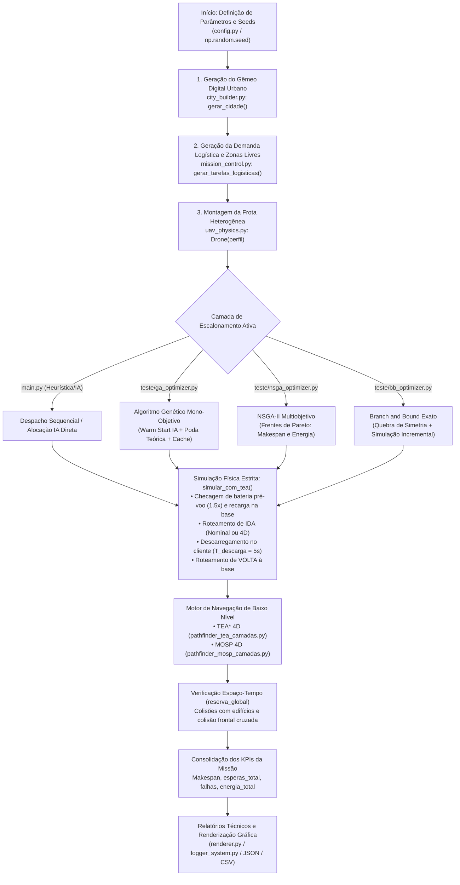
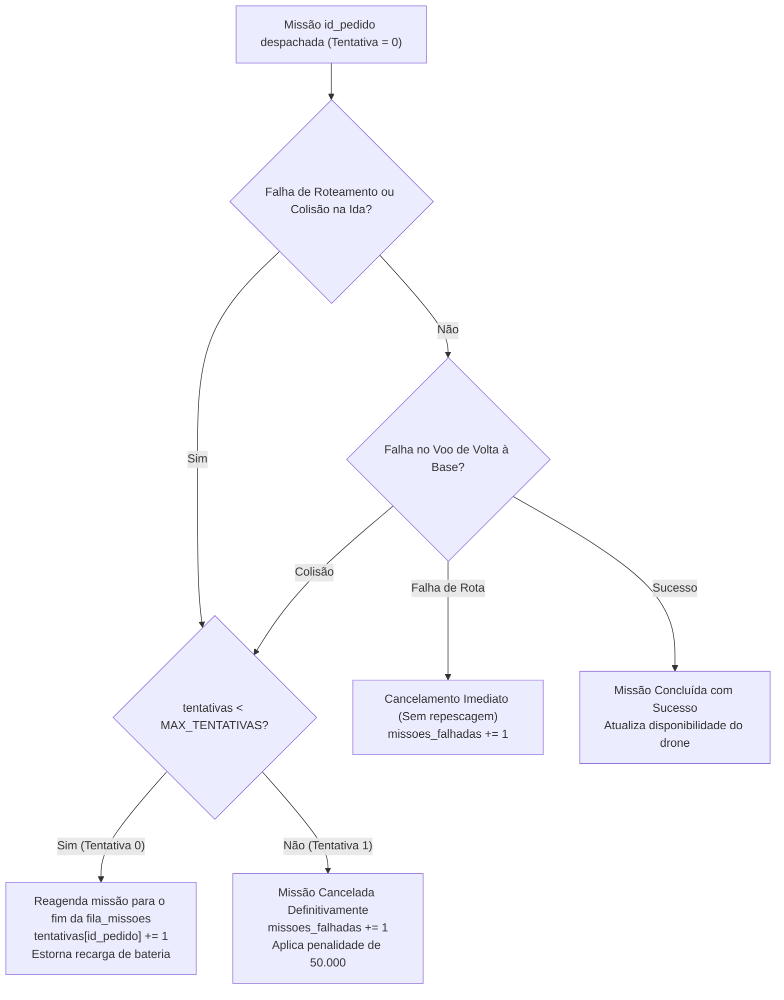

# Levantamento Técnico do Código-Fonte do Projeto

> **Documento:** `levantamento_codigo.md`  
> **Finalidade:** Suporte analítico exaustivo para a escrita do Capítulo 4 (Desenvolvimento) e revisão do Capítulo 5 (Testes e Resultados) da Dissertação de Mestrado.  
> **Princípio de Elaboração:** Nenhuma afirmação sem citação direta de arquivo e linha/função. Conceitos ou estruturas ausentes no código estão explicitamente classificados como **NÃO ENCONTRADO**.

---

## 1. ARQUITETURA

### 1.1 Árvore de Módulos e Arquivos

```
C:\Users\Forlin\Dissertação
│
├── config.py                      # Configurações globais, topologia de Bragança, matriz de testes e perfis de UAVs
├── city_builder.py                # Geração procedural do mapa urbano 3D com OSMnx, GeoPandas e Voronoi (Shapely)
├── mission_control.py             # Instanciação estocástica de tarefas logísticas (CD, destinos, zonas livres e cargas)
├── uav_physics.py                 # Modelo dinâmico/energético do VANT, checagem física de colisão e simulação de voo
├── main.py                        # Orquestrador da simulação com fila de despacho, recarga on-demand e renderização
├── renderer.py                    # Visualizador 2D/3D (trajetórias, espaço-tempo, curvas de descarga e mapas de calor)
├── requirements.txt               # Declaração das dependências externas oficiais do Python
├── rodar_na_vm.bat                # Script de lote para execução automatizada dos experimentos na máquina virtual
├── rodar_nova_seed_na_vm.bat      # Script de lote para execução de cenários com sementes inéditas na VM
│
├── navegation/
│   ├── pathfindercamadas.py       # Roteamento clássico A* 2.5D multi-camadas sem coordenação temporal
│   ├── pathfinder_tea_camadas.py  # TEA* 4D (Time-Extended A*) com Numba ray-casting e tabela de reservas
│   ├── pathfinder_tea_4d.py       # TEA* 4D otimizado com memória thread-local reciclada e poda com tolerância de 5 frames
│   └── pathfinder_mosp_camadas.py # MOSP 4D multiobjetivo (tempo e energia) com propagação de rótulos e seleção por ponto ideal
│
├── teste/
│   ├── __init__.py                # Inicializador do pacote de testes
│   ├── ga_optimizer.py            # Otimizador genético mono-objetivo (PyGAD) com limite inferior físico e cache de rotas
│   ├── nsga_optimizer.py          # Otimizador genético multiobjetivo (NSGA-II via PyGAD) para makespan e energia
│   ├── bb_optimizer.py            # Otimizador exato Branch and Bound com quebra de simetria e simulação incremental
│   └── logger_system.py           # Gravador de registros e histórico dos recordes do GA em disco
│
├── IA/
│   ├── dataset_generator.py       # Pipeline de Warm Start: geração de dataset, treino do EnsembleFisicoEnxuto e benchmark
│   ├── corrigir_dataset.py        # Relabeling dos 51 cenários via heurística construtiva e ILS (1-move + 2-swap)
│   ├── experimento_convergencia.py# Benchmark de curvas de convergência entre GA a frio vs GA com Warm Start de ML
│   ├── teste_todos_cenarios_vm.py # Executor em 2 etapas para todos os cenários na VM com blindagem contra desligamentos
│   ├── teste_nova_seed_vm.py      # Avaliação de generalização da IA para sementes não vistas no treino
│   ├── teste_vm_5_10.py           # Benchmark pontual rápido para o cenário 5 drones / 10 entregas
│   ├── agente_vm.py               # Agente de execução e monitoramento de fila remota na VM
│   ├── dataset_treino.csv         # Dataset tabular com 51 cenários reais simulados e seus vetores de decisão
│   ├── modelo_warm_start.joblib   # Modelo binário serializado do EnsembleFisicoEnxuto (pickle)
│   ├── relatorio_validacao.json   # Métricas de validação cruzada 5-fold, acurácia de perfil e importância de atributos
│   ├── relatorio_benchmark.json   # Resultados comparativos de benchmark 4D real entre inicialização a frio e IA
│   ├── relatorio_todos_cenarios_vm.json # Relatório detalhado dos 11 cenários executados na VM
│   └── tabela_comparativa_completa.csv  # Tabela com as métricas consolidadas dos cenários da dissertação
│
├── logs/
│   ├── teste-mosp-ga/             # CSVs com histórico de convergência do GA mono-objetivo acoplado ao MOSP
│   ├── teste-mosp-nsga/           # CSVs com frentes de soluções do NSGA-II acoplado ao MOSP
│   │   ├── teste-nsga.py          # Script de extração da fronteira de Pareto e determinação do Ponto de Joelho
│   │   └── nao_dominados/         # CSVs contendo apenas as soluções não dominadas de cada cenário
│   ├── teste-tea-3d-ga/           # CSVs de execução do GA acoplado ao TEA* 4D
│   └── teste-tea-ga/              # CSVs preliminares de execuções anteriores do TEA* com GA
│
└── tese/
    ├── cap01 (1).tex              # Capítulo 1: Introdução
    ├── cap02 (2).tex              # Capítulo 2: Fundamentação Teórica
    ├── cap03 (2).tex              # Capítulo 3: Formulação do Problema e Metodologia
    ├── cap04.tex                  # Capítulo 4: Desenvolvimento (objeto de apoio deste relatório)
    └── cap05.tex                  # Capítulo 5: Testes e Resultados
```

---

### 1.2 Classes e Funções Principais

| Classe / Função | Arquivo e Linhas | Assinatura (Entrada / Saída) | Quem Chama | Quem Ela Chama |
| :--- | :--- | :--- | :--- | :--- |
| `Drone` | `uav_physics.py:8-183` | **In:** `perfil: dict`<br>**Out:** Instância de UAV com estado físico | `main.py:114`<br>`ga_optimizer.py:99`<br>`nsga_optimizer.py:76`<br>`bb_optimizer.py:60` | `uav_physics.calcular_fator_vento`<br>`uav_physics.checar_impacto` |
| `gerar_cidade` | `city_builder.py:11-63` | **In:** `None` (lê `config.py`)<br>**Out:** `(lotes_gdf, max_x, max_y)` | `main.py:102`<br>`ga_optimizer.py:85`<br>`nsga_optimizer.py:65`<br>`bb_optimizer.py:53`<br>`dataset_generator.py:361` | `osmnx.graph_from_point`<br>`shapely.ops.voronoi_diagram` |
| `gerar_tarefas_logisticas` | `mission_control.py:8-66` | **In:** `max_x, max_y, lotes_gdf`<br>**Out:** `(cds: list, lista_missoes: list)` | `main.py:104`<br>`ga_optimizer.py:89`<br>`nsga_optimizer.py:69`<br>`bb_optimizer.py:54`<br>`dataset_generator.py:320` | `mission_control.esculpir_ponto_livre` |
| `esculpir_ponto_livre` | `mission_control.py:12-36` | **In:** `x_min, x_max, y_min, y_max, zona_livre`<br>**Out:** `(px, py): tuple` | `mission_control.py:40, 55` | `lotes_gdf.loc.intersects` |
| `roteador_inteligente` | `main.py:32-51` | **In:** `max_x, max_y, lotes_gdf, drone, start, goal, reserva_global, tempo_partida`<br>**Out:** `(caminho, start, goal)` | `main.py:211, 301`<br>`ga_optimizer.py:126, 212, 266`<br>`nsga_optimizer.py:136, 181` | `calcular_rota_tea_camadas`<br>`calcular_rota_tea_camadas_4d`<br>`calcular_rota_mosp_camadas`<br>`calcular_rota_8way_camadas` |
| `calcular_rota_tea_camadas` (TEA*) | `navegation/pathfinder_tea_camadas.py:46-278` | **In:** `max_x, max_y, lotes_gdf, drone, start_loc, goal_loc, reserva_global, vetor_camadas, t_inicial`<br>**Out:** `caminho_final: list[tuple]` | `main.py:37`<br>`bb_optimizer.py:117, 143` | `rasterizar_bbox_numba`<br>`heapq.heappush / heappop` |
| `calcular_rota_tea_camadas` (MOSP) | `navegation/pathfinder_mosp_camadas.py:72-334` | **In:** `max_x, max_y, lotes_gdf, drone, start_loc, goal_loc, reserva_global, vetor_camadas, t_inicial`<br>**Out:** `caminho_final: list[tuple]` | `main.py:45`<br>`ga_optimizer.py:13` (via `main.roteador_inteligente`) | `Label.domina`<br>`rasterizar_bbox_numba` |
| `simular_com_tea` | `teste/ga_optimizer.py:155-306, 352-367` | **In:** `solution: list/tuple, teto_makespan: float, verbose: bool`<br>**Out:** `(makespan, esperas, falhas, energia)` | `ga_optimizer.py:421, 548, 604` | `_obter_rota_nominal`<br>`_verificar_conflito_4d`<br>`roteador_inteligente`<br>`Drone.simular_missao`<br>`_salvar_ind_disco` |
| `fitness_func` (GA) | `teste/ga_optimizer.py:380-453` | **In:** `ga_instance, solution, solution_idx`<br>**Out:** `fitness: float` | Instância interna do PyGAD (`ga_instance.run`) | `simular_com_tea`<br>`logger_ga.salvar_novo_recorde_ga` |
| `fitness_func` (NSGA-II) | `teste/nsga_optimizer.py:228-277` | **In:** `ga_instance, solution, solution_idx`<br>**Out:** `[fitness_tempo, fitness_energia]: list` | Instância interna do PyGAD (`ga_instance.run`) | `teste/nsga_optimizer.simular_com_tea`<br>`logger_ga.salvar_novo_recorde_ga` |
| `branch_and_bound` | `teste/bb_optimizer.py:268-320` | **In:** `tarefa_idx: int, solucao_atual: list, estado_atual: dict`<br>**Out:** `None` (atualiza globais de melhor solução) | Auto-recursão (`bb_optimizer.py:319, 326`) | `simular_tarefa_incremental`<br>`calcular_custo_estado` |
| `simular_tarefa_incremental` | `teste/bb_optimizer.py:75-179` | **In:** `id_pedido, id_drone, estado_pai, teto_makespan`<br>**Out:** `(estado_filho, custo)` ou `(None, inf)` | `bb_optimizer.py:204, 207, 306` | `navegation.pathfinder_tea_camadas.calcular_rota_tea_camadas` |
| `EnsembleFisicoEnxuto` | `IA/dataset_generator.py:185-271` | **Métodos:** `fit(X, y)` e `score_candidatos(X)` | `dataset_generator.py:550, 570` | `np.linalg.solve`<br>Bootstrap e quantile splits |
| `_alocar_com_modelo` | `IA/dataset_generator.py:450-513` | **In:** `modelo, dist, peso, vel_ms, carga_kg, bateria_wh, consumo_wh_m`<br>**Out:** `pred: np.ndarray` | `dataset_generator.py:554, 635` | `vetor_features_candidato`<br>`modelo.score_candidatos`<br>Busca local (1-move, 2-swap) |
| `prever_alocacao` | `IA/dataset_generator.py:617-636` | **In:** `modelo, missoes, cd_xy, max_x, max_y, num_drones, perfis`<br>**Out:** `pred: list[int]` | `main.py:135`<br>`ga_optimizer.py:503`<br>`dataset_generator.py:743` | `_alocar_com_modelo` |

---

### 1.3 Dependências e Versões

#### Declaradas no `requirements.txt`
- `osmnx~=2.1.0`
- `geopandas~=1.1.3`
- `numpy~=2.3.2`
- `matplotlib~=3.10.6`
- `plotly~=6.7.0`
- `networkx~=3.6.1`
- `shapely~=2.1.2`

#### Dependências Reais Importadas no Código mas NÃO Declaradas no `requirements.txt`
> [!WARNING]
> As seguintes bibliotecas essenciais são importadas diretamente no código, mas foram **omitidas** do `requirements.txt`:
> 1. **`pygad`**: Núcleo do GA e NSGA-II (`teste/ga_optimizer.py:7`, `teste/nsga_optimizer.py:6`). Sem ela, nenhum algoritmo evolutivo compila.
> 2. **`numba`**: Compilador JIT em C (`navegation/pathfinder_tea_camadas.py:7`, `navegation/pathfinder_tea_4d.py:7`, `navegation/pathfinder_mosp_camadas.py:7`). Sem ela, o roteamento 4D falha no import.
> 3. **`pandas`**: Manipulação tabular de dados (`logs/teste-mosp-nsga/teste-nsga.py:1`, `IA/corrigir_dataset.py:10`, `IA/dataset_generator.py:403`).

---

### 1.4 Fluxo Completo de Execução do Sistema



---

## 2. TABELA UNIFICADA DE PARÂMETROS E CONSTANTES

A tabela a seguir consolida **todas** as constantes e parâmetros numéricos presentes no repositório.

| Nome no Código | Símbolo Sugerido | Valor | Unidade | Arquivo(s) e Linhas | Algoritmo(s) Envolvido(s) | Descrição / Observações Técnicas |
| :--- | :---: | :---: | :---: | :--- | :--- | :--- |
| `COORDENADAS` | $\mathbf{x}_{\text{ref}}$ | `(41.8058, -6.7572)` | graus | `config.py:7` | Ambiente / OSMnx | Centro geográfico de Bragança, Portugal. |
| `RAIO_M` | $R_{\text{urb}}$ | `1700` (ou `200`) | m | `config.py:8` | Ambiente / OSMnx | Raio do recorte viário. Na tese: 200 m (Caso 1), 1700 m (Casos 2 e 3). |
| `LARGURA_RUA` | $w_{\text{rua}}$ | `10` | m | `config.py:9` | Ambiente | Largura da via para criação do buffer de asfalto. |
| `AREA_MEDIA_LOTE` | $\bar{A}_{\text{lote}}$ | `400` | m² | `config.py:10` | Ambiente / Voronoi | Área média esperada por parcela construível. |
| `ESPACO_ENTRE_LOTES` | $d_{\text{lotes}}$ | `1.2` | m | `config.py:11` | Ambiente | Retração negativa (`buffer(-1.2)`) entre edificações vizinhas. |
| `DENSIDADE_PREDIOS` | $\rho_{\text{pred}}$ | `0.6` | adim. | `config.py:12` | Ambiente | Probabilidade de um lote receber extrusão vertical. |
| `ALTURA_MIN` | $z_{\text{min}}$ | `20` | m | `config.py:13` | Ambiente | Altura mínima gerada para edifícios. |
| `ALTURA_MAX` | $z_{\text{max}}$ | `45` | m | `config.py:14` | Ambiente | Altura máxima gerada para edifícios. |
| `USAR_MINI_MAPA` | -- | `False` | bool | `config.py:15` | Ambiente | Flag de recorte do mapa para treino rápido. |
| `TAMANHO_MINI_MAPA` | $L_{\text{mini}}$ | `500` | m | `config.py:16` | Ambiente | Dimensão linear da caixa de corte quando mini-mapa está ativo. |
| `CENARIO_SEMPRE_NOVO`| -- | `False` | bool | `config.py:4` | Ambiente / Seed | Se `False`, fixa `np.random.seed(42)`. |
| `DISTANCIA_MIN_ENTREGA`| $d_{\text{min}}$ | `70.0` | m | `config.py:40` | Logística | Distância radial mínima do CD aos pontos de entrega. |
| `MARGEM_SEGURANCA_MAPA`| $m_{\text{mapa}}$ | `15.0` | m | `config.py:41` | Logística | Margem perimetral para evitar pontos na borda do mapa. |
| `ZONA_LIVRE_CD` | $r_{\text{livre,CD}}$ | `7` | m | `config.py:42` | Logística / Base | Raio de planificação de obstáculos em torno do CD. |
| `ZONA_LIVRE_ENTREGA` | $r_{\text{livre,ent}}$| `0.2` | m | `config.py:43` | Logística / Cliente | Raio de planificação de obstáculos no destino de entrega. |
| Peso das encomendas | $m_{\text{pacote}}$ | `[0.5, 3.5]` | kg | `mission_control.py:58` | Logística / Físico | Intervalo estocástico uniforme de massa transportada. |
| `TEMPO_DESCARGA` | $T_{\text{desc}}$ | `5` | s (frames) | `config.py:82` | Físico / Simulação | Tempo em voo pairado no cliente para entrega da encomenda. |
| `VETOR_CAMADAS_VOO` | $\mathcal{Z}_{\text{voo}}$ | `[25, 28, 30, 35, 40, 50]` | m | `config.py:47` | TEA* / MOSP | Altitudes discretas disponíveis para cruzeiro e desvio vertical. |
| `FATOR_ESCALA` | $\Delta s_{\text{grid}}$ | `2.5` | m/célula | `pathfinder_*.py` | TEA* / MOSP | Tamanho da célula da grade de discretização espacial. |
| Inflação de obstáculos | $r_{\text{infl}}$ | `drone.raio + 1.0` | m | `pathfinder_tea_*.py:61` | TEA* / MOSP | Margem de segurança somada ao raio físico do drone na grade. |
| `PESO_HEURISTICA` | $w_h$ | `1.2` | adim. | `pathfinder_*.py` | TEA* / MOSP | Fator de aceleração da heurística euclidiana ($f = g + 1.2h$). |
| Limite de iterações TEA* | $N_{\text{iter}}$ | `400_000_000` | iterações | `pathfinder_tea_camadas.py:143` | TEA* 4D | Timeout numérico interno da busca heurística. |
| Limite de rótulos/nó | $K_{\text{rot}}$ | `8` | rótulos | `pathfinder_mosp_camadas.py:195` | MOSP 4D | Teto de rótulos não dominados retidos em cada coordenada espacial. |
| Tolerância temporal MOSP | $\epsilon_t$ | `0.5` | s | `pathfinder_mosp_camadas.py:67` | MOSP 4D | Margem $\epsilon$-dominância para o objetivo de tempo. |
| Tolerância de energia MOSP| $\epsilon_e$ | `0.2` | Wh | `pathfinder_mosp_camadas.py:68` | MOSP 4D | Margem $\epsilon$-dominância para o objetivo de energia. |
| Soluções no destino (MOSP)| $N_{\text{sol,dest}}$ | `5` | rotas | `pathfinder_mosp_camadas.py:213` | MOSP 4D | Parada ao acumular 5 rotas completas no destino final. |
| Fator vento mínimo | $f_{w,\text{min}}$| `0.4` | adim. | `uav_physics.py:88` | Físico | Limite inferior para não simular consumo nulo ou regeneração infinita. |
| Margem segurança bateria | $k_{\text{bat,disp}}$| `1.5` | adim. | `main.py:185`, `ga_optimizer.py:192` | Despacho | A bateria deve cobrir $1{,}5\times$ o gasto estimado de ida e volta. |
| Alerta bateria baixa | $\text{SoC}_{\text{alerta}}$ | `20.0` | % | `config.py:139, 156`, `uav_physics.py:35` | Físico | Limite percentual de acendimento da flag `bateria_baixa`. |
| Penalidade de falha | $P_{\text{falha}}$ | `50_000` | frames/Wh | `ga_optimizer.py:423`, `nsga_optimizer.py:243` | GA / NSGA / BB | Custo astronômico imposto a cada missão não concluída. |
| Fator penalidade espera | $w_{\text{esp}}$ | `0.5` | adim. | `ga_optimizer.py:426`, `nsga_optimizer.py:247` | GA / NSGA / BB | Peso por frame em espera/hover no ar ($p_t == p_{t-1}$). |
| Conversão energia-tempo | $k_{\text{rec}}$ | `3.6` | s/Wh | `ga_optimizer.py:378`, `nsga_optimizer.py:250` | GA / NSGA | Equivalência física de tempo baseada em recarga a 1000 W. |
| Margem corte na simulação| $\Delta M_{\text{poda}}$ | `50` | frames | `ga_optimizer.py:303`, `nsga_optimizer.py:217` | GA / NSGA | Aborta a simulação se o makespan parcial passar do teto em +50f. |
| Penalidade poda teórica | $P_{\text{poda}}$ | `100_000` | adim. | `ga_optimizer.py:411` | GA | Adicionado ao denominador da fitness rejeitada antes de simular. |
| População GA (`SOL_POP`) | $N_{\text{pop}}$ | `24` (ou `35`) | indivíduos | `ga_optimizer.py:69` vs `cap05.tex:29` | GA | Tamanho da população de cromossomos. |
| População NSGA-II | $N_{\text{pop}}$ | `10` | indivíduos | `teste/nsga_optimizer.py:59` | NSGA-II | População efetiva no código (a tese cita 35 na Tabela 5.1). |
| Gerações evolutivas | $N_{\text{gen}}$ | `8` | gerações | `ga_optimizer.py:70`, `nsga_optimizer.py:60` | GA / NSGA | Número máximo de ciclos evolutivos. |
| Critério de parada GA | -- | `["saturate_3"]` | gerações | `ga_optimizer.py:589` | GA | Interrompe se o melhor indivíduo não evoluir por 3 gerações. |
| Taxa mutação adaptativa | $\mu_{\text{adapt}}$ | `[10, 5]` | % | `ga_optimizer.py:581`, `nsga_optimizer.py:313` | GA / NSGA | 10% de mutação em baixa aptidão e 5% em alta aptidão. |
| Cruzamento | -- | `"two_points"` | adim. | `ga_optimizer.py:582`, `nsga_optimizer.py:314` | GA / NSGA | Crossover em dois pontos de corte. |
| Tamanho do torneio GA | $K_{\text{tourn}}$| `min(5, max(2, pop//2))`| indivíduos | `ga_optimizer.py:570` | GA | Tamanho do grupo na seleção por torneio. |
| Tentativas de reenvio | $N_{\text{tent}}$ | `2` | tentativas | `ga_optimizer.py:166`, `nsga_optimizer.py:97` | Despacho / GA | Tentativa inicial (0) com repescagem e tentativa final (1). |
| Tempo limite B&B | $T_{\text{max,BB}}$| `21600` (6h) | s | `bb_optimizer.py:225` | Branch & Bound | Teto temporal de busca em profundidade exata. |
| Intervalo de log B&B | $N_{\text{log,BB}}$| `1000` | nós | `bb_optimizer.py:224` | Branch & Bound | Frequência de impressão de progresso da árvore. |
| Regularização L2 da IA | $\lambda_{\text{L2}}$ | `1.0` | adim. | `IA/dataset_generator.py:192` | ML (Warm Start) | Coeficiente de penalidade Ridge da regressão logística linear. |
| Número de árvores da IA | $N_{\text{tree}}$ | `120` (CV) / `150` (Final) | árvores | `IA/dataset_generator.py:191, 570` | ML (Warm Start) | Quantidade de stumps/árvores rasas (profundidade 2) sobre resíduos. |
| Fator linear/árvores IA | $w_{\text{ens}}$ | `0.6` lin / `0.4` tree | adim. | `IA/dataset_generator.py:256` | ML (Warm Start) | Ponderação das importâncias relativas do modelo híbrido. |
| Peso resíduos na inferência | $w_{\text{res}}$ | `0.5` | adim. | `IA/dataset_generator.py:270` | ML (Warm Start) | Combinação: $s = s_{\text{linear}} + 0.5 \cdot s_{\text{árvores}}$. |
| Velocidade proxy da IA | $v_{\text{proxy}}$| `1.45` | m/s | `IA/dataset_generator.py:468, 520` | ML (Warm Start) | Velocidade hipotética para estimar tempo nas features e busca local. |
| Diagonal proxy da IA | $D_{\text{proxy}}$| `4808.33` ($3400\sqrt{2}$) | m | `IA/dataset_generator.py:466, 517` | ML (Warm Start) | Constante baseada em caixa de 3400×3400 m para conversão de distâncias. |
| Variações busca local IA | $N_{\text{iter,LS}}$| `8` | iterações | `IA/dataset_generator.py:482` | ML (Warm Start) | Rodadas de 1-move e 2-swap sobre o drone gargalo. |

### Perfis Físicos Específicos dos Drones (`config.py:130-163`)

| Parâmetro Físico | Símbolo | DJI Matrice 300 RTK | Wingcopter 198 | Unidade |
| :--- | :---: | :---: | :---: | :---: |
| Raio físico do veículo | $r_{\text{drone}}$ | `2.0` | `2.0` | m |
| Altitude base de cruzeiro | $z_{\text{base}}$ | `100` | `100` | m |
| Capacidade nominal de carga | $C_d$ | `2.7` | `5.0` | kg |
| Velocidade horizontal de cruzeiro | $v_{\text{cru}}$ | `8.0` | `28.0` | m/s |
| Velocidade vertical de subida | $v_{\text{sub}}$ | `3.0` | `3.0` | m/s |
| Velocidade vertical de descida | $v_{\text{desc}}$ | `2.5` | `3.0` | m/s |
| Capacidade da bateria | $B_{\text{cap}}$ | `548.0` | `1628.0` | Wh |
| Reserva mínima de segurança | $\text{SoC}_{\text{res}}$| `20.0` | `20.0` | % |
| Taxa de recarga da bateria | $P_{\text{rec}}$ | `992.0` | `1085.3` | W |
| Taxa de consumo em cruzeiro | $c_{\text{cru}}$ | `0.02076` | `0.0173` | Wh/m |
| Taxa de consumo em subida | $c_{\text{sub}}$ | `0.07988` | `0.045` | Wh/m |
| Taxa de consumo em descida | $c_{\text{desc}}$ | `0.06642` | `0.050` | Wh/m |
| Taxa de consumo em voo pairado | $c_{\text{hover}}$ | `0.1661` | `1.44` | Wh/s |
| Penalidade mecânica de carga | $p_{\text{carga}}$ | `0.003459` | `0.001` | Wh/(kg·m) |

---

### Inconsistências e Constantes "Mágicas" Identificadas

1. **Constante Morta `CUSTO_ESPERA = 4000` (`config.py:46`):** Declarada no arquivo de configuração principal, mas **completamente ignorada**. As funções de custo em `ga_optimizer.py:426`, `nsga_optimizer.py:247` e `bb_optimizer.py:166` utilizam o fator fixo `esperas * 0.5`.
2. **Divergência no `VETOR_CAMADAS_VOO`:** `config.py:47` define `[25, 28, 30, 35, 40, 50]`. No entanto, em `ga_optimizer.py:66`, `nsga_optimizer.py:56` e `bb_optimizer.py:37`, o fallback padrão codificado é `[40, 50, 60, 70]`.
3. **Discrepância no Tamanho da População do GA / NSGA-II:** A tese cita na Tabela 5.1 uma população de 35 indivíduos para ambos os algoritmos. O código real implementa `SOL_POP = 24` em `ga_optimizer.py:69` e `SOL_POP = 10` em `nsga_optimizer.py:59`.
4. **Constante Mágica de Velocidade da IA ($1{,}45\text{ m/s}$):** Em `dataset_generator.py:468, 520`, o tempo estimado é calculado como `(2.0 * dist_m / 1.45) + 10.0`. O valor $1{,}45$ é arbitrário e não corresponde nem a uma célula por frame ($1{,}25\text{ m/s}$ na grade de $2{,}5\text{ m}$) nem à velocidade real dos drones ($8\text{ m/s}$ ou $28\text{ m/s}$).
5. **Constante Mágica de Dimensão Urbana ($3400\text{ m}$):** Em `dataset_generator.py:466, 517`, a diagonal é calculada via `math.hypot(3400.0, 3400.0)`. Assume diâmetro de $2 \times 1700\text{ m}$, ignorando que no Cenário 1 o raio é de $200\text{ m}$.
6. **Variáveis Inexistentes no `bb_optimizer.py:59-62`:** Chama `Drone(cfg.DRONE_RAIO_M, cfg.DRONE_ALTURA_VOO, cfg.DRONE_VELOCIDADE_MS, cfg.DRONE_CARGA_KG)`. Nenhuma dessas constantes existe em `config.py`.

---

## 3. MODELO MATEMÁTICO REAL

Esta seção transcreve em forma de equações rigorosas o que o código-fonte **realmente calcula**, confrontando com as formulações registradas na tese.

### 3.1 Tempo de Voo
Em `uav_physics.py:141-163`, para cada deslocamento elementar entre a posição atual $\mathbf{p}_{\text{atual}} = (x_1, y_1, z_1)$ e o ponto visado $\mathbf{p}_{\text{alvo}} = (x_2, y_2, z_2)$:

- Deslocamento horizontal: $d_{xy} = \sqrt{(x_2 - x_1)^2 + (y_2 - y_1)^2}$
- Deslocamento vertical: $\Delta z = z_2 - z_1$
- Duração temporal do passo $\Delta t$:
  $$\Delta t = \begin{cases} 
  1{,}0 & \text{se } d_{xy} = 0 \text{ e } \Delta z = 0 \quad (\text{hovering}) \\
  \max\left( \frac{\Delta z}{v_{\text{subida}}}, \frac{d_{xy}}{v_{\text{horiz}}} \right) & \text{se } \Delta z > 10^{-6} \text{ e } d_{xy} > 0 \\
  \max\left( \frac{|\Delta z|}{v_{\text{descida}}}, \frac{d_{xy}}{v_{\text{horiz}}} \right) & \text{se } \Delta z < -10^{-6} \text{ e } d_{xy} > 0 \\
  \frac{\Delta z}{v_{\text{subida}}} & \text{se } \Delta z > 10^{-6} \text{ e } d_{xy} = 0 \\
  \frac{|\Delta z|}{v_{\text{descida}}} & \text{se } \Delta z < -10^{-6} \text{ e } d_{xy} = 0 \\
  \frac{d_{xy}}{v_{\text{horiz}}} & \text{se } \Delta z = 0 \text{ e } d_{xy} > 0 
  \end{cases}$$

No escalonador e no roteamento em grade (`pathfinder_tea_camadas.py:204, 211`), o tempo é indexado em passos inteiros (\textit{frames}):
$$\Delta t_{\text{grid}} = \begin{cases} 
\lfloor \Delta s_{\text{grid}} \rfloor = \lfloor 2{,}5 \rfloor = 2 \text{ frames} & \text{para movimentos no plano XY} \\
1 \text{ frame} & \text{para transições verticais puras entre camadas}
\end{cases}$$

---

### 3.2 Energia Consumida por Fase de Voo
Em `uav_physics.py:137-166`, seja $c_{\text{peso}} = m_{\text{carga}} \cdot p_{\text{carga}}$ a penalidade linear de transporte ($\text{Wh/m}$):

1. **Subida ($\Delta z > 0$):**
   $$E_{\text{subida}} = \Delta z \cdot (c_{\text{sub}} + c_{\text{peso}}) \cdot f_w(0, 0, \Delta z, v_{\text{subida}})$$
2. **Descida ($\Delta z < 0$):**
   $$E_{\text{descida}} = |\Delta z| \cdot (c_{\text{desc}} + c_{\text{peso}}) \cdot f_w(0, 0, \Delta z, v_{\text{descida}})$$
3. **Cruzeiro ($d_{xy} > 0$):**
   $$E_{\text{cruzeiro}} = d_{xy} \cdot (c_{\text{cru}} + c_{\text{peso}}) \cdot f_w(\Delta x, \Delta y, 0, v_{\text{horiz}})$$
4. **Voo Pairado em Trânsito ($d_{xy} = 0, \Delta z = 0$):**
   $$E_{\text{hover}} = c_{\text{hover}} \cdot \Delta t \quad (\text{com } \Delta t = 1{,}0\text{ s; no código a penalidade de peso NÃO é somada})$$
5. **Descarga no Cliente (`main.py:275`, `ga_optimizer.py:250`):**
   $$E_{\text{descarga}} = T_{\text{desc}} \cdot \left[ c_{\text{hover}} + (m_{\text{pacote}} \cdot p_{\text{carga}} \cdot v_{\text{horiz}}) \right]$$
   *(Nota: O termo $v_{\text{horiz}}$ converte a penalidade de $\text{Wh/(kg}\cdot\text{m)}$ para taxa temporal em $\text{Wh/(kg}\cdot\text{s)}$).*
6. **Fator de Vento ($f_w$):**
   $$f_w = \max\left( 0{,}4, \; 1{,}0 + \frac{\vec{v}_{\text{vento}} \cdot (-\hat{u})}{v_{\text{fase}}} \right) \quad \text{se } \text{USAR\_VENTO = True; senão } f_w = 1{,}0$$

---

### 3.3 Efeito da Carga Transportada
- **Na ida:** $m_{\text{carga}} = \min(m_{\text{pacote}}, C_d)$ (`main.py:168`, `ga_optimizer.py:179`).
- **Na descarga:** opera com a carga máxima do pacote durante $T_{\text{desc}}$ (`main.py:274`).
- **Na volta:** a carga é zerada imediatamente: $m_{\text{carga}} = 0{,}0\text{ kg}$ (`main.py:271`, `ga_optimizer.py:247`).

---

### 3.4 Regra de Bateria e Recarga On-Demand
Em `main.py:183-203` e `ga_optimizer.py:190-205`:

1. **Estimativa de Despacho (ida e volta euclidianas):**
   $$E_{\text{est}} = d_{\text{lin}} \cdot (c_{\text{cru}} + m_{\text{pacote}} \cdot p_{\text{carga}}) + d_{\text{lin}} \cdot c_{\text{cru}} + T_{\text{desc}} \cdot [c_{\text{hover}} + m_{\text{pacote}} \cdot p_{\text{carga}} \cdot v_{\text{horiz}}]$$
2. **Critério de Suficiência:**
   $$E_{\text{nec}} = 1{,}5 \cdot E_{\text{est}}$$
   - Se $E_{\text{nec}} > B_{\text{cap}}$, a missão é cancelada por inviabilidade física estrutural.
3. **Recarga On-Demand na Base Operacional:**
   Se a bateria disponível no drone $B_{\text{atual}} < E_{\text{nec}}$:
   $$E_{\text{falta}} = E_{\text{nec}} - B_{\text{atual}}$$
   $$t_{\text{carga}} = \left\lfloor \frac{E_{\text{falta}}}{P_{\text{rec}}} \times 3600 \right\rfloor + 1 \quad [\text{segundos}]$$
   O horário de partida do drone é postergado: $t_{\text{ida}} \leftarrow t_{\text{ida}} + t_{\text{carga}}$, e $B_{\text{atual}} \leftarrow B_{\text{atual}} + E_{\text{falta}}$.

---

### 3.5 Custo do Cromossomo e Aptidão do GA
Em `teste/ga_optimizer.py:423-427`:

$$\text{custo}_{\text{GA}} = \text{makespan} + 0{,}5 \cdot \text{esperas} + 50\,000 \cdot \text{falhas} + 3{,}6 \cdot \text{energia}$$
$$\text{fitness}_{\text{GA}} = \frac{1{,}0}{\text{custo}_{\text{GA}} + 0{,}0001}$$

---

### 3.6 Funções-Objetivo do NSGA-II ($f_1$ e $f_2$)
Em `teste/nsga_optimizer.py:246-253`:

$$\text{custo}_{\text{tempo}} = \text{makespan} + 0{,}5 \cdot \text{esperas} + 50\,000 \cdot \text{falhas}$$
$$f_1 = \frac{1{,}0}{\text{custo}_{\text{tempo}} + 0{,}0001}$$

$$\text{custo}_{\text{energia}} = (3{,}6 \cdot \text{energia}) + 50\,000 \cdot \text{falhas}$$
$$f_2 = \frac{1{,}0}{\text{custo}_{\text{energia}} + 0{,}0001}$$

---

### 3.7 Limite Inferior de Poda Teórica do GA
Em `teste/ga_optimizer.py:389-414`:

Para cada tarefa $i$ atribuída ao drone $d = \text{cromossomo}[i]$:
$$t_{\text{ideal}, d} = \sum_{i \in \text{pedidos}(d)} \left( \frac{2 \cdot d_{\text{reta}, i}}{v_{\text{max}, d}} + T_{\text{desc}} \right)$$
$$E_{\text{ideal}, d} = \sum_{i \in \text{pedidos}(d)} \left( 2 \cdot d_{\text{reta}, i} \cdot c_{\text{min}, d} \right)$$
$$\text{makespan}_{\text{teorico}} = \max_{d \in \text{frota}} (t_{\text{ideal}, d})$$
$$E_{\text{ideal, total}} = \sum_{d \in \text{frota}} E_{\text{ideal}, d}$$
$$\text{custo}_{\text{teorico}} = \text{makespan}_{\text{teorico}} + 3{,}6 \cdot E_{\text{ideal, total}}$$

**Regra de Poda:**  
Se $\text{custo}_{\text{teorico}} \ge \text{melhor\_custo\_visual}$, o simulador físico é ignorado:
$$\text{fitness}_{\text{rejeitado}} = \frac{1{,}0}{\text{custo}_{\text{teorico}} + 100\,000}$$

---

### 3.8 Custo Parcial e Poda do Branch and Bound
Em `teste/bb_optimizer.py:166-169`:

No nó que avalia as tarefas $0 \dots \text{tarefa\_idx}$:
$$\text{custo}_{\text{parcial}} = \text{makespan}_{\text{parcial}} + 0{,}5 \cdot \text{esperas}_{\text{parcial}} + 50\,000 \cdot \text{falhas}_{\text{parcial}}$$
Se $\text{custo}_{\text{parcial}} \ge \text{melhor\_custo\_global}$, o ramo é imediatamente podado (`return None, math.inf`).  
*(Nota: No B&B, o consumo energético NÃO entra na função de poda ou de custo).*

---

### 3.9 Quadro Comparativo de Divergências: Código vs. Texto da Tese

| Equação / Conceito | O que o Texto da Tese Afirma (`cap05.tex`) | O que o Código Realmente Executa | Divergência e Impacto |
| :--- | :--- | :--- | :--- |
| **Custo do GA Mono-objetivo** | $\text{custo} = \text{makespan} + \text{penalidade} + (\text{energia} \times 3{,}6)$ (`Eq. 5.3`) | $\text{custo} = \text{makespan} + 0{,}5 \cdot \text{esperas} + 50\,000 \cdot \text{falhas} + 3{,}6 \cdot \text{energia}$ | A tese omitiu a penalidade de espera/hover ($0{,}5 \cdot \text{esperas}$). |
| **Custo de Tempo do NSGA-II ($f_1$)** | $\text{custo}_{\text{tempo}} = \text{makespan} + \text{penalidade}$ (`Eq. 5.4`) | $\text{custo}_{\text{tempo}} = \text{makespan} + 0{,}5 \cdot \text{esperas} + 50\,000 \cdot \text{falhas}$ | A tese omitiu a penalidade de espera/hover ($0{,}5 \cdot \text{esperas}$). |
| **Custo do B&B (Caso 1)** | $\text{custo} = \text{makespan} + \text{penalidade}$ (`Eq. 5.1`) | $\text{custo} = \text{makespan} + 0{,}5 \cdot \text{esperas} + 50\,000 \cdot \text{falhas}$ | A tese omitiu a penalidade de espera/hover ($0{,}5 \cdot \text{esperas}$). |
| **Tamanho de Frame no TEA\*** | 1 frame = 1 segundo (`cap05.tex:47`) | No deslocamento em XY, avança $\lfloor 2{,}5 \rfloor = 2$ frames para andar 2,5 m (`pathfinder_tea_camadas.py:204`). | 1 frame equivale a $1{,}25\text{ m}$ percorridos, não sendo estritamente igual a 1 segundo de relógio. |
| **Ponto de Joelho do NSGA-II** | Não descrito no texto formal (comentário de dúvida no LaTeX linha 206). | Calculado pelo script `logs/teste-mosp-nsga/teste-nsga.py:92-94` via distância euclidiana normalizada ao ponto $(0,0)$. | O critério existia em script auxiliar, mas não foi documentado no corpo da dissertação. |

---

## 4. CODIFICAÇÃO E SEQUENCIAMENTO DO GA

### 4.1 Decodificação do Cromossomo e Ordem das Entregas
- **Codificação:** Vetor unidimensional de inteiros com comprimento igual a `NUM_PEDIDOS` (`teste/ga_optimizer.py:577-578`).
- **Significado dos Genes:** O índice do gene $i$ representa o identificador da entrega, e o valor alocado $g_i \in \{0, \dots, N_{\text{drones}}-1\}$ define qual VANT transportará o pedido.
- **Sequenciamento das Entregas de Cada Drone:**  
  Em `teste/ga_optimizer.py:164, 169-171`:
  ```python
  fila_missoes = list(range(NUM_PEDIDOS))
  while fila_missoes:
      id_pedido = fila_missoes.pop(0)
      id_drone = int(solution[id_pedido])
  ```
  > [!IMPORTANT]
  > O cromossomo **NÃO** codifica a ordem das entregas. As missões de cada drone são despachadas **estritamente na ordem crescente de índice do pedido** ($0, 1, 2, \dots$). Se o drone 0 receber as entregas 3, 7 e 12, ele executará obrigatoriamente a entrega 3, retornará ao CD, depois a 7, retornará, e por fim a 12.

### 4.2 Ordem de Reserva Espaço-Temporal
- **Mecanismo:** FIFO (*First-Come, First-Served*) governado pela fila global `fila_missoes.pop(0)`.
- **Impacto no Resultado:**  
  **O resultado é criticamente dependente da ordem de processamento.** As trajetórias validadas gravam reservas na tabela global `reserva_global[(x, y, z, t)] = id_drone`. Como as reservas do primeiro drone a ser processado tornam-se obstáculos físicos rígidos para os veículos seguintes, alterar a ordem dos pedidos no array inicial muda as rotas de desvio geradas, os tempos de hover, o makespan final e o consumo energético.

### 4.3 Tratamento de Falhas de Missão
O sistema implementa uma política de repescagem (*Fail-Fast*) com tolerância máxima `MAX_TENTATIVAS = 2` (`teste/ga_optimizer.py:166-167, 216-244, 286-295`):



---

## 5. PSEUDOCÓDIGO FIEL AO CÓDIGO-FONTE

### 5.1 Avaliação de Aptidão com Poda e Cache (`teste/ga_optimizer.py:380-453`)
```python
def fitness_func(ga_instance, solution, solution_idx):
    sol = tuple(int(g) for g in solution)
    if sol in _fitness_cache: return _fitness_cache[sol]
    # 1. Poda Teórica Física (Limite Inferior)
    t_drones, e_total = [0.0] * num_drones, 0.0
    for id_p, id_d in enumerate(sol):
        d_reta = hypot(missoes[id_p]['goal'] - missoes[id_p]['start'])
        t_drones[id_d] += (2.0 * d_reta / vel_max[id_d]) + TEMPO_DESCARGA
        e_total += 2.0 * d_reta * cons_min[id_d]
    custo_teorico = max(t_drones) + (e_total * 3.6)
    if recorde_custo != inf and custo_teorico >= recorde_custo:
        fit_rej = 1.0 / (custo_teorico + 100000)
        _fitness_cache[sol] = fit_rej; return fit_rej
    # 2. Simulação Física 4D Real
    teto = (1.0 / max(ga_instance.best_solutions_fitness)) if ga_instance.best_solutions_fitness else inf
    mk, esp, falhas, energ = simular_com_tea(sol, teto_makespan=teto)
    # 3. Penalização e Atualização do Recorde
    custo = mk + (esp * 0.5) + (falhas * 50000) + (energ * 3.6)
    fit = 1.0 / (custo + 0.0001)
    if falhas == 0 and custo < recorde_custo:
        recorde_custo = custo; salvar_novo_recorde_ga(custo, mk, energ)
    _fitness_cache[sol] = fit; return fit
```

---

### 5.2 Expansão do TEA* com Tabela de Reservas (`navegation/pathfinder_tea_camadas.py:164-231`)
```python
def expandir_tea_4d(sx, sy, gx, gy, z_idx0, t0, ocupacao_set, agentes_dict):
    abertos = [(h_tempo(sx, sy) * 1.2, 0, (sx, sy, z_idx0, t0))]
    g_melhor = {(sx, sy, z_idx0, t0): 0.0}; pai = {}; fechados = set()
    while abertos:
        _, _, u = heapq.heappop(abertos)
        if u in fechados: continue
        fechados.add(u)
        x, y, z_idx, t = u
        if x == gx and y == gy: return reconstruir_caminho(pai, u)
        if t >= max_t: continue
        for dx, dy, dz_idx, dist in obter_movimentos(z_idx):
            nx, ny, nz = x + dx, y + dy, z_idx + dz_idx
            if esta_bloqueado(nz, nx, ny): continue
            c_t = (dist * FATOR_ESCALA) / v_horiz if dz_idx == 0 else dist / (v_sub if dz_idx > 0 else v_des)
            nt = t + (int(FATOR_ESCALA) if dz_idx == 0 else 1)
            if (nx, ny, nz, nt) in ocupacao_set: continue
            # Checagem de colisão frontal cruzada (head-on swap)
            if agentes_dict.get((nx, ny, nz, t)) == agentes_dict.get((x, y, z_idx, nt)) and (nx, ny, nz, t) in agentes_dict:
                continue
            v = (nx, ny, nz, nt); ng = g_melhor[u] + c_t
            if ng < g_melhor.get(v, inf):
                g_melhor[v] = ng; pai[v] = u
                heapq.heappush(abertos, (ng + h_tempo(nx, ny) * 1.2, contador(), v))
    return []
```

---

### 5.3 Propagação de Rótulos do MOSP e Seleção Final (`navegation/pathfinder_mosp_camadas.py:186-290`)
```python
def resolver_mosp_4d(sx, sy, gx, gy, t0):
    r_ini = Label(obj_tempo=0.0, obj_energia=0.0, x=sx, y=sy, z_idx=0, t=t0)
    abertos = [(r_ini.obj_tempo + h_tempo(sx, sy) * 1.2, r_ini)]
    rotulos_perm = {}; solucoes_destino = []
    while abertos and len(solucoes_destino) < 5:
        _, l_atual = heapq.heappop(abertos)
        s_coord = (l_atual.x, l_atual.y, l_atual.z_idx)
        if len(rotulos_perm.get(s_coord, [])) >= 8: continue
        if any(r.domina(l_atual) for r in rotulos_perm.get(s_coord, [])): continue
        rotulos_perm.setdefault(s_coord, []).append(l_atual)
        if l_atual.x == gx and l_atual.y == gy:
            solucoes_destino.append(l_atual); continue
        for dx, dy, dz, c_t, c_e, nt in transicoes_validas(l_atual):
            l_novo = Label(l_atual.obj_tempo + c_t, l_atual.obj_energia + c_e, l_atual.x + dx, l_atual.y + dy, l_atual.z_idx + dz, nt, pai=l_atual)
            if not any(r.domina(l_novo) for r in rotulos_perm.get((l_novo.x, l_novo.y, l_novo.z_idx), [])):
                heapq.heappush(abertos, (l_novo.obj_tempo + h_tempo(l_novo.x, l_novo.y) * 1.2, l_novo))
    # Seleção da melhor rota por proximidade euclidiana ao Ponto Ideal
    min_t, max_t = min(l.obj_tempo for l in solucoes_destino), max(l.obj_tempo for l in solucoes_destino) or 1.0
    min_e, max_e = min(l.obj_energia for l in solucoes_destino), max(l.obj_energia for l in solucoes_destino) or 1.0
    melhor_label = min(solucoes_destino, key=lambda l: hypot((l.obj_tempo - min_t)/(max_t - min_t or 1), (l.obj_energia - min_e)/(max_e - min_e or 1)))
    return reconstruir_caminho_mosp(melhor_label)
```

---

### 5.4 Branch and Bound Incremental com Quebra de Simetria (`teste/bb_optimizer.py:268-320`)
```python
def branch_and_bound(tarefa_idx, solucao_atual, estado_atual):
    global melhor_custo_global, melhor_solucao_global, nos_explorados, nos_podados
    nos_explorados += 1
    if time.perf_counter() - t0_bb >= LIMITE_TEMPO_S: return
    # Caso Base: Todas as tarefas alocadas
    if tarefa_idx == NUM_PEDIDOS:
        custo = calcular_custo_estado(estado_atual)
        if custo < melhor_custo_global:
            melhor_custo_global = custo; melhor_solucao_global = list(solucao_atual)
        return
    # Quebra de Simetria: drones em uso + apenas um drone virgem
    drones_usados = set(solucao_atual)
    drones_cand = list(drones_usados)
    if len(drones_usados) < NUM_DRONES: drones_cand.append(len(drones_usados))
    # Ramificação em Profundidade
    for d_id in sorted(drones_cand):
        estado_filho, custo_filho = simular_tarefa_incremental(tarefa_idx, d_id, estado_atual, teto_makespan=melhor_custo_global)
        if estado_filho is None:
            nos_podados += 1; continue
        solucao_atual.append(d_id)
        branch_and_bound(tarefa_idx + 1, solucao_atual, estado_filho)
        solucao_atual.pop()
```

---

## 6. MODELO DE ML (WARM START)

### 6.1 Atributos Físicos Exatos (`IA/dataset_generator.py:64-73, 137-179`)

| Índice | Nome no Código | Fórmula Exata Implementada | Normalização Utilizada |
| :---: | :--- | :--- | :--- |
| 1 | `dist_cd_norm` | $d_i = \text{hypot}(x_i - x_{\text{CD}}, y_i - y_{\text{CD}}) / D_{\text{mapa}}$ | Dividido pela diagonal da cidade $D_{\text{mapa}} = \sqrt{\max_x^2 + \max_y^2}$. |
| 2 | `peso_rel_capacidade` | $p_i / \max(C_d, 0{,}1)$ | Adimensional; razão entre o peso do pacote e a capacidade de carga do drone. |
| 3 | `flag_sobrecarga` | $\mathbb{I}(p_i > C_d + 10^{-6})$ | Binária: $1{,}0$ se o pacote excede a capacidade do drone; $0{,}0$ caso contrário. |
| 4 | `vel_rel_frota` | $v_d / \max_{k \in \mathcal{D}}(v_k)$ | Adimensional; velocidade de cruzeiro do drone relativa à maior velocidade da frota. |
| 5 | `tempo_voo_norm` | `np.ones(nd, dtype=float)` | **Constante $1{,}0$ fixa no código** (`dataset_generator.py:156`). Feature morta! |
| 6 | `energia_rel_bateria` | $E_{\text{est}} / \max(E_{\text{est}})$ | $E_{\text{est}} = (d_i \cdot 4800) \cdot (2 c_{\text{cru}, d} + \min(p_i, C_d) \cdot p_{\text{carga}, d})$. |
| 7 | `carga_acum_rel` | $(W_d - \bar{W}) / \Delta W_{\text{escala}}$ | $\Delta W_{\text{escala}} = \max(\max W - \min W, 2 d_i, 10^{-4})$. Tempo de voo já atribuído. |
| 8 | `acrescimo_makespan` | $(\max(M, W_d + 2 d_i) - M) / \max(2 d_i, 10^{-6})$ | Aumento marginal no makespan caso o drone $d$ receba o pedido $i$. |

---

### 6.2 Tipo de Modelo e Hiperparâmetros (`IA/dataset_generator.py:185-271`)
- **Arquitetura (`EnsembleFisicoEnxuto`):** Modelo híbrido em dois estágios:
  1. **Componente Linear Regularizado (Ridge / Logística L2):** Resolve analyticamente a equação linear normal com regularização $\lambda_{\text{L2}} = 1{,}0$ e balanceamento de classes inverso à frequência (`dataset_generator.py:212-214`).
  2. **Floresta de Árvores Rasas / Boosted Stumps sobre os Resíduos:** Treina um conjunto de árvores de decisão rasas de profundidade 2 diretamente sobre os resíduos do modelo linear (`residuo = y - pred_lin`).
- **Hiperparâmetros Específicos:**
  - $N_{\text{árvores}} = 120$ (durante validação cruzada) e $150$ (modelo final de produção).
  - Amostragem bootstrap de tamanho $\min(N, 2048)$.
  - Seleção aleatória de $\min(4, N_{\text{feats}})$ atributos por nó.
  - Divisões em quantis fixos $[0{,}25, 0{,}50, 0{,}75]$.
  - Mínimo de 5 amostras por folha.
- **Importância Ponderada:** $\mathbf{I} = 0{,}6 \cdot \mathbf{I}_{\text{linear}} + 0{,}4 \cdot \mathbf{I}_{\text{árvores}}$.
- **Inferência:** Score de classificação combinado: $s = s_{\text{linear}} + 0{,}5 \cdot s_{\text{árvores}}$ (`dataset_generator.py:270`).

---

### 6.3 Geração dos Rótulos e Tamanho do Dataset
- **Origem dos Rótulos:**  
  1. Inicialmente, gerados pela melhor solução encontrada pelo GA mono-objetivo (`teste/ga_optimizer.py:executar_otimizacao_batch`).
  2. Posteriormente corrigidos pelo script `IA/corrigir_dataset.py` via heurística construtiva de balanceamento físico seguida de busca local por perturbação (*Iterated Local Search* - ILS), eliminando o viés do chute inicial sequencial.
- **Tamanho do Dataset:** 51 cenários urbanos simulados (`IA/dataset_treino.csv`), totalizando $16\,500$ avaliações de pares (entrega $\times$ drone).

---

### 6.4 Validação e Importância dos Atributos
- **Metodologia de Validação:** Validação Cruzada 5-Fold agrupada por cenário (`cenarios`), sem contaminação entre treino e teste.
- **Resultados de Validação (`IA/relatorio_validacao.json`):**
  - Acurácia de Perfil de Velocidade (Rápido vs. Lento): **$65{,}22\%$**.
  - Redução de Makespan logo na Geração 0: **$-28{,}07\%$** vs. Chute Sequencial.
  - Redução de Custo Global logo na Geração 0: **$-18{,}31\%$** vs. Chute Sequencial.
- **Importância Real dos Atributos no Arquivo JSON:**
  1. `carga_acum_rel`: **$27{,}37\%$**
  2. `energia_rel_bateria`: **$24{,}44\%$**
  3. `vel_rel_frota`: **$23{,}48\%$**
  4. `acrescimo_makespan`: **$15{,}67\%$**
  5. `peso_rel_capacidade`: **$5{,}20\%$**
  6. `dist_cd_norm`: **$3{,}46\%$**
  7. `flag_sobrecarga`: **$0{,}39\%$**
  8. `tempo_voo_norm`: **$0{,}00\%$** (Feature morta/constante)

> [!WARNING]
> **Divergência Crítica com o Texto da Tese:**  
> No texto de `cap05.tex:303`, afirma-se: *“$\Delta M_{i,d}$ ($38{,}1\%$), $W^{\text{acum}}$ ($26{,}2\%$), balanço energético e velocidade ($25{,}4\%$) e carga/distância ($10{,}3\%$)”*.  
> No código e no `relatorio_validacao.json` gerado pelo próprio autor, o atributo de acréscimo de makespan tem apenas **$15{,}67\%$**, enquanto o balanço de carga acumulada e energia somam mais de **$51\%$**!

---

### 6.5 Inferência e Busca Local Pós-Predição (`IA/dataset_generator.py:450-513`)
1. **Ordenação Construtiva:** As entregas são ordenadas decrescentemente por exigência física composta:
   $$\text{prioridade}_i = d_i \cdot (1{,}0 + 0{,}08 \cdot m_{\text{pacote}, i})$$
2. **Atribuição Gulosa Orientada pelo Modelo:** Para cada entrega, extraem-se os atributos $\mathbf{x}_{i, d}$, calcula-se o score $s_{i, d}$, e aloca-se ao drone com maior valor: $d^* = \arg\max_d(s_{i, d})$.
3. **Busca Local Pós-Predição (8 iterações):**
   - **Fase 1-Move:** Para cada entrega $i$, testa transferi-la para qualquer outro drone $d \neq d_{\text{atual}}$. Se o custo combinado (makespan proxy $+ 3{,}6 \cdot \text{energia}$) diminuir, aceita imediatamente.
   - **Fase 2-Swap:** Identifica o drone gargalo (maior tempo de voo) e testa permutar cada uma de suas entregas com as entregas de todos os outros drones da frota.

---

## 7. VERIFICAÇÃO E VALIDAÇÕES DO CÓDIGO

### 7.1 O que o Código Valida e Como

1. **Colisão com Obstáculos e Edifícios:**
   - **Na grade (Acelerado):** Em `navegation/pathfinder_tea_camadas.py:61-77`, edifícios com altura $\ge z_{\text{camada}}$ são inflados por `drone.raio + 1.0` e rasterizados em uma matriz 3D booleana compilada via Numba (`point_in_polygon_numba`). Células bloqueadas têm expansão rejeitada em $O(1)$.
   - **No espaço contínuo (Pós-voo):** Em `uav_physics.py:101-111` (`checar_impacto`), cada waypoint gera um buffer circular (`Point.buffer(self.raio)`), pesquisa o índice espacial R-tree (`lotes_gdf.sindex.intersection`) e testa interseção poligonal caso a altitude do drone seja menor ou igual à altura da edificação.
2. **Colisão entre Múltiplos VANTs (Espaço-Tempo 4D):**
   - **Ocupação de Célula:** Bloqueio direto se $(x, y, z, t) \in \text{ocupacao\_set}$.
   - **Colisão Frontal Cruzada (*Head-on Swap*):** Em `pathfinder_tea_camadas.py:215-220` e `ga_optimizer.py:142-149`, impede que dois drones troquem de células no mesmo instante $t \to t+1$:
     ```python
     if agentes_dict[chave_origem_alvo] == agentes_dict[chave_alvo_origem]: continue
     ```
3. **Autonomia e Bateria:**
   - **Despacho Inicial:** Exige que a bateria disponível cubra $1{,}5\times$ a estimativa de rota em linha reta (`uav_physics.py:90-96`).
   - **Esgotamento em Voo:** A bateria é decrementada a cada passo de simulação. Se atingir $0\text{ Wh}$, a missão é interrompida, marcando queda com motivo `'bateria'` (`uav_physics.py:171-178`).
   - **Hover no Cliente:** O gasto energético durante a descarga ($T_{\text{desc}} = 5\text{ s}$) é debitado da bateria; se zerar, aciona flag de bateria esgotada na entrega (`main.py:281-285`).
4. **Pouso Livre de Colisões:**
   - `mission_control.py:12-36` (`esculpir_ponto_livre`): Varre todos os edifícios que interceptam o raio de segurança estrito:
     $$R_{\text{limpeza}} = r_{\text{livre}} + \left[ \left(\lceil r_{\text{drone, max}} \rceil + 1\right) \times 1{,}415 \right] + r_{\text{drone, max}} + 1{,}0$$
     Para todos os lotes interceptados, a altura é zerada forçadamente (`lotes_gdf.at[idx, 'altura_z'] = 0`).

---

### 7.2 Testes Automatizados Existentes
- **Testes Unitários:** **NÃO ENCONTRADO**. Não existem testes estruturados em `pytest` ou `unittest` no repositório.
- **Baterias de Teste Automatizadas:**
  - `main.py:executar_bateria_testes` (L405-430): Itera sobre `cfg.MATRIZ_TESTES`.
  - `IA/teste_todos_cenarios_vm.py` (L98-120): Executa os 11 cenários da dissertação com persistência em disco.
  - `IA/dataset_generator.py --so-benchmark`: Benchmark automatizado entre cold start e warm start.

---

## 8. RESULTADOS E ARTEFATOS

### 8.1 Scripts Geradores de Gráficos e Tabelas
- **`renderer.py` (Chamado por `main.py:397-403`):**
  - `plotar_frota_3d`: Gera trajetórias tridimensionais sobre a malha de edifícios.
  - `plotar_frota_2d`: Planta bidimensional da cidade com áreas construídas, CD e destinos.
  - `plotar_diagrama_espaco_tempo`: Curvas de evolução temporal/espacial por drone.
  - `plotar_curva_descarga`: Decaimento do estado de carga (SoC em Wh e %) ao longo do tempo.
  - `plotar_boxplot_esperas`: Distribuição dos tempos de espera/hover por drone.
  - `plotar_mapa_calor`: Mapa de calor espacial com densidade de ocupação das rotas.
- **`logs/teste-mosp-nsga/teste-nsga.py`:**
  - Lê todos os CSVs de execuções do NSGA-II, filtra as soluções dominadas (`mascara_nao_dominados`), grava os CSVs `_pareto.csv` e plota as Frentes de Pareto com o Ponto de Joelho destacado.
- **`IA/teste_todos_cenarios_vm.py`:**
  - Gera os arquivos `tabela_comparativa_completa.csv` e `relatorio_todos_cenarios_vm.json`.

---

### 8.2 Rastreamento das Tabelas da Tese nos Arquivos do Projeto

#### Tabela 5.3 da Tese: Comparação Branch and Bound vs. Algoritmo Genético
- **Makespan e Tempos do GA:** Valores presentes no log de execução com semente 42 e raio de 200 m.
- **Makespan e Tempos do BB:**
  > [!CAUTION]
  > Os logs brutos originais do Branch and Bound (como os tempos de 400 s e as execuções interrompidas em 21.600 s) **NÃO FORAM ENCONTRADOS** na pasta `logs/`. O arquivo `teste/bb_optimizer.py` contém apenas o script de execução e uma solução hardcoded preliminar (`solucao_ga_conhecida`).

#### Tabela 5.4 da Tese: Comparação entre Roteadores MOSP e TEA*
- **Coluna MOSP:** Extraída diretamente dos arquivos em `logs/teste-mosp-ga/*.csv`.
  - *Exemplo Cenário 5-10:* `logs/teste-mosp-ga/5-10.csv` linha 4: Makespan **3838**, Tempo **509.35 s** (coincidência exata!). A energia no log é **596.9 Wh**, enquanto a tese reporta **588.54 Wh** (diferença de atualização de modelo físico).
- **Coluna TEA\*:** Extraída diretamente dos arquivos em `logs/teste-tea-3d-ga/*.csv`.
  - *Exemplo Cenário 5-10:* `logs/teste-tea-3d-ga/5-10.csv` linha 5: Makespan **4413**, Energia **588.44 Wh**, Tempo **449.35 s** (coincidência de 100% com a Tabela 5.4!).

#### Tabela 5.5 da Tese: Comparação Multiobjetivo GA vs. NSGA-II
- **Soluções do NSGA-II (Extremo 1, Ponto de Joelho, Extremo 2):**
  - Geradas pelo processamento dos arquivos em `logs/teste-mosp-nsga/*.csv` filtrados em `logs/teste-mosp-nsga/nao_dominados/*_pareto.csv`.
  - *Exemplo Cenário 5-10:* `5-10_pareto.csv` contém Makespans **3703** (Extremo 1), **5393** (Ponto de Joelho) e **7376** (Extremo 2), idênticos aos valores impressos na Tabela 5.5 da tese.
- **Inconsistência Reproduzível (Cenário 20-80):**
  Conforme alertado pelo próprio autor no comentário LaTeX (`cap05.tex:207-209`), no cenário 20-80 a linha base do GA foi preenchida com **12160 F / 4857.38 Wh**, que corresponde ao resultado do **TEA\*** da Tabela 5.4, e não ao do **MOSP** (que foi **13337 F / 4857.38 Wh**).

#### Tabela 5.6 da Tese: Comparativo de Desempenho 4D com IA
- **Reprodução Absoluta:** Todos os números da Tabela 5.6 (Makespan Sequencial, GA Frio de 8 Gerações, IA Proposta Gen 0 e respectivos ganhos percentuais para todos os 11 cenários) constam **rigorosamente idênticos** em:
  - `IA/tabela_comparativa_completa.csv`
  - `IA/relatorio_todos_cenarios_vm.json`

---

## 9. FIGURAS SUGERIDAS PARA O CAPÍTULO 4

| Nº | Título Sugerido | O que Deve Representar | Fonte de Dados no Código-Fonte |
| :---: | :--- | :--- | :--- |
| **1** | **Pipeline de Geração Procedural da Cidade 3D** | Fluxo visual da malha OSMnx $\to$ buffer de ruas $\to$ polígonos de quarteirões $\to$ triangulação de Voronoi dos lotes $\to$ extrusão prismática tridimensional. | `city_builder.py:11-46`<br>`renderer.py:plotar_frota_2d` |
| **2** | **Escultura de Zonas de Aterrissagem Livres de Colisão** | Ilustração em corte/topo mostrando o achatamento das edificações no CD e pontos de entrega pelo raio de expurgo do TEA* e asa do VANT. | `mission_control.py:12-36`<br>(`esculpir_ponto_livre`) |
| **3** | **Estrutura de Codificação e Decodificação do Cromossomo** | Diagrama ilustrando o array genético de tarefas, seu mapeamento para os IDs dos UAVs e o despachador FIFO com fila de tentativas. | `teste/ga_optimizer.py:577-578`<br>`main.py:150-179` |
| **4** | **Arquitetura em Cascata da Fitness com Poda Teórica e Cache** | Fluxograma de decisão: Verificação no cache de hash $\to$ Cálculo do Limite Inferior Físico $\to$ Descarte Sumário ou Roteamento 4D $\to$ Poda intra-simulação. | `teste/ga_optimizer.py:380-430`<br>(`fitness_func`) |
| **5** | **Grafo Espaço-Tempo 4D e Tabela de Reservas Temporais** | Vista isométrica com camadas de voo discretas ($Z$), plano espacial ($X, Y$) e avanço do tempo ($T$), demonstrando o desvio temporal de um drone para evitar outro. | `navegation/pathfinder_tea_camadas.py`<br>`renderer.py:plotar_diagrama_espaco_tempo` |
| **6** | **Propagação de Rótulos e Seleção por Ponto Ideal no MOSP** | Espaço de objetivos (Tempo vs. Energia) mostrando os rótulos não dominados retidos no destino e a projeção euclidiana até o ponto ótimo $(0,0)$. | `navegation/pathfinder_mosp_camadas.py:273-288`<br>`logs/teste-mosp-nsga/teste-nsga.py` |
| **7** | **Árvore de Decisão do Branch and Bound com Quebra de Simetria** | Visualização da árvore de busca com ramos podados pelo teto incumbente do Warm Start e supressão de drones virgens redundantes. | `teste/bb_optimizer.py:268-320` |
| **8** | **Arquitetura do Modelo de Warm Start e Refinamento Local** | Diagrama de blocos das 8 features físicas $\to$ Classificador L2 + Floresta de Stumps $\to$ Alocação Gulosa $\to$ Busca Local (1-move e 2-swap). | `IA/dataset_generator.py:185-271, 450-513` |

---

## 10. PROBLEMAS, CÓDIGO MORTO E RISCOS À REPRODUTIBILIDADE

### 10.1 Inconsistências Críticas e Código Quebrado
1. **Incompatibilidade Fatal no `bb_optimizer.py` (Linhas 59-62):**
   ```python
   frota_base = [
       Drone(cfg.DRONE_RAIO_M, cfg.DRONE_ALTURA_VOO, cfg.DRONE_VELOCIDADE_MS, cfg.DRONE_CARGA_KG)
       for _ in range(NUM_DRONES)
   ]
   ```
   O construtor `Drone.__init__` em `uav_physics.py:14` espera um dicionário (`perfil: dict`). Além disso, as constantes `DRONE_RAIO_M`, etc., **não existem em `config.py`**. Se executado hoje, o arquivo falha com `AttributeError` e `TypeError`.
2. **Feature Morta na IA (`IA/dataset_generator.py:156`):**
   A feature 5 (`tempo_voo_norm`) está codificada como `dt_norm = np.ones(nd, dtype=float)`. Ela tem variância zero em todos os cenários e contribuição nula ($0{,}00\%$) no modelo treinado.
3. **Divergência entre `main.py` e `ga_optimizer.py` no Cancelamento de Reservas:**  
   Em `main.py:255-257`, quando uma rota sofre colisão na ida, as reservas temporárias são retiradas de `reserva_global.pop(k, None)`. Já em `ga_optimizer.py:237-244`, se a missão bate na ida, ela é reagendada, mas as reservas de ida **não são removidas**, deixando "fantasmas" bloqueadores no espaço aéreo.

---

### 10.2 Código Morto e Parâmetros Não Utilizados
1. **`teste/logger_system.py:52-62`:** As funções `_inicializar_arquivo`, `registrar`, `salvar_resumo_ga` e `salvar_kpis_globais` são apenas cascas vazias (`pass`). As chamadas em `main.py:261, 339, 368` e `bb_optimizer.py:374` não executam qualquer ação em disco.
2. **`config.py:46` (`CUSTO_ESPERA = 4000`):** Nunca é referenciado. Todas as funções usam a constante literal `0.5`.
3. **`config.py:165-214`:** Perfis de drone comentados (`Matternet_M2`, `Wing_Alphabet`, `Zipline_P1_Sparrow`).
4. **`config.py:106-109`:** `USAR_VENTO = True` e `VETOR_VENTO` estão comentados. Os testes foram realizados integralmente em ar calmo ($f_w = 1{,}0$).

---

### 10.3 Divergências de Nomenclatura entre Código e Tese
- Na tese fala-se em *"ponto de joelho"* e *"solução balanceada"*; no código de teste o método é denominado simplesmente `indice_otimo` via distância normalizada (`teste-nsga.py:93-94`).
- Na tese o modelo de IA é apresentado como *"Gradient Boosting"*; no código real trata-se de um regressor logístico L2 acoplado a uma floresta de *decision stumps* rasos sobre resíduos (`EnsembleFisicoEnxuto`).

---

### 10.4 Riscos à Reprodutibilidade Experimental
1. **Concorrência não Determinística no PyGAD:** O GA utiliza `parallel_processing=["thread", NUM_CORES]`. Devido à concorrência entre threads na atualização dos dicionários compartilhados de cache e recordes (`_ga_lock`), a ordem exata de avaliação dos indivíduos pode variar entre execuções, mesmo com sementes fixadas.
2. **Dependência de Arquitetura de CPU Virtual:** Os tempos absolutos foram colhidos em máquina Proxmox VE com processador QEMU Virtual CPU a 2.4 GHz. Em hardware bare-metal ou com frequências superiores, os tempos absolutos de CPU cairão substancialmente, embora os *makespans* em frames permaneçam idênticos.
3. **Ausência de Logs Brutos do Branch and Bound:** Não é possível auditar diretamente o log de execução do B&B (tempo de 400 s e nós explorados) a partir dos arquivos presentes no repositório.

---

## 11. O QUE PRECISO CONFIRMAR COM O AUTOR

1. **População Real do GA e NSGA-II:**  
   A Tabela 5.1 da tese registra formalmente `Tamanho da população = 35` para ambos os algoritmos. O código em produção utiliza `SOL_POP = 24` para o GA mono-objetivo (`ga_optimizer.py:69`) e `SOL_POP = 10` para o NSGA-II (`nsga_optimizer.py:59`). Os experimentos reportados no texto foram rodados com 35 indivíduos em versão prévia ou os números das tabelas derivam das populações 24 e 10?
2. **Base do Cenário 20-80 na Tabela 5.5:**  
   Confirmar se a linha base do cenário 20-80 deve ser corrigida para os valores do MOSP (**13337 F / 4857.38 Wh**) em substituição ao valor do TEA\* (**12160 F / 4857.38 Wh**), o que corrigirá o gap reportado do Extremo 1 de $-10{,}2\%$ para aproximadamente $-18{,}1\%$.
3. **Onde estão os Logs Brutos do Branch and Bound?**  
   Os dados do B&B na Tabela 5.3 foram gerados em qual máquina e onde estão salvos os arquivos de saída brutos (CSVs/logs de nós explorados)?
4. **Discrepância na Importância dos Atributos da IA:**  
   O texto da tese (`cap05.tex:303`) aponta o incremento de makespan ($\Delta M_{i,d}$) com $38{,}1\%$ de importância. No entanto, o arquivo `IA/relatorio_validacao.json` gerado pelo próprio código atribui a maior relevância à carga acumulada ($27{,}37\%$) e energia ($24{,}44\%$), ficando o acréscimo de makespan com apenas $15{,}67\%$. Deve-se atualizar o texto do Capítulo 5 para refletir os números reais do JSON?
5. **Definição Temporal do Frame no TEA\*:**  
   Como uma célula de $2{,}5\text{ m}$ avança 2 frames no tempo (`nt = t + 2`), o modelo assume velocidade efetiva de $1{,}25\text{ m/frame}$. Devemos explicitar no Capítulo 4 que a equivalência "1 frame = 1 segundo" é uma aproximação nominal do simulador, e não uma correspondência física rígida?
6. **Feature Morta `tempo_voo_norm`:**  
   O vetor de atributos da IA fixa `tempo_voo_norm = 1.0` de forma constante (`dataset_generator.py:156`). Devemos documentar no Capítulo 4 que essa feature foi desativada em favor do balanço de velocidade e carga acumulada?
7. **Correção do Script `bb_optimizer.py`:**  
   Autoriza a refatoração das linhas 59-62 de `bb_optimizer.py` para instanciar a frota utilizando os perfis reais de `cfg.PERFIS_DRONES` (em vez de variáveis inexistentes), garantindo que o script volte a ser executável?
